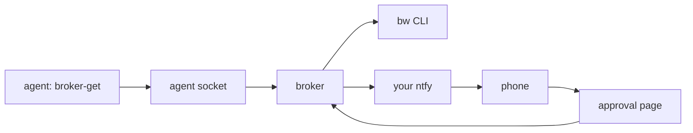

# bw2fabroker

A small Go broker in front of the Bitwarden CLI. An agent asks for **one field of one item**. You
approve it on your phone: a push from **your own ntfy domain** opens an approval page on **your
tailnet**, and you type your **approval password**. The broker then returns that one value to the
agent once, in a fixed JSON shape. Nothing else passes between the broker and the agent.

```
agent ──broker-get──▶ broker ──push──▶ your ntfy server ──▶ iPhone
                        ▲                                      │
                        └──── approval page on the tailnet ◀───┘ (approval password)
```

- Only the broker holds the Bitwarden session key. The agent never runs `bw`.
- The broker logs in as a **separate agents account** that sees only one collection.
- No database. Pending requests live in memory; a restart cancels them.
- Design and review: [docs/DEV_PLAN.md](docs/DEV_PLAN.md). Agent instructions:
  [skills/bw-broker/SKILL.md](skills/bw-broker/SKILL.md).

## What you need

- Tailscale on the broker host (required; the broker checks it is installed and connected) and on
  your phone.
- A self-hosted ntfy server on your own domain, with HTTPS. The broker refuses `ntfy.sh`, any other
  domain, plain HTTP, and redirects.
- A Bitwarden server: self-hosted Vaultwarden / Bitwarden, or Bitwarden cloud.
- A separate Bitwarden account for agents, with agent-safe items in one organization collection
  shared with it.

## Install (app mode, Linux + systemd)

```sh
make install                    # binaries to /usr/local/bin, systemd unit, user "broker", group "broker-clients"
npm install -g @bitwarden/cli   # bw must be on PATH for the broker user

sudo -u broker -H env BROKER_CONFIG=/etc/bw2fabroker/config.toml HOME=/var/lib/bw2fabroker sh -c '
  broker init --ntfy-domain ntfy.example.com            # prints the admin token once
  BITWARDENCLI_APPDATA_DIR=/var/lib/bw2fabroker/bw bw config server https://vault.example.com
  BITWARDENCLI_APPDATA_DIR=/var/lib/bw2fabroker/bw bw login --apikey   # agents account API key
'
# Open http://127.0.0.1:8788/admin with that token. Set ntfy, the agent HTTP
# address (the tailnet IP), and an agent. The broker CLI cannot do this.
sudo systemctl enable --now bw2fabroker
sudo -u broker env BROKER_CONFIG=/etc/bw2fabroker/config.toml broker unlock   # agents account master password
sudo -u broker env BROKER_CONFIG=/etc/bw2fabroker/config.toml broker doctor
```

Agents call `http://<tailnet-ip>:<agent-port>` with their own bearer token. There is no agent socket.

Docker mode (with a Tailscale sidecar): see [deploy/docker/README.md](deploy/docker/README.md).

## Use from an agent

```sh
export BROKER_TOKEN=bwb_...                          # or BROKER_TOKEN_FILE
export BROKER_URL=http://100.x.y.z:8786              # agent HTTP API on the tailnet

# Preferred: the value goes only into the command's environment.
broker-get --env PGPASSWORD staging-db password --reason "run migrations on staging" -- psql -h db -c 'select 1'

# Print the value (it lands in the agent's transcript).
broker-get staging-db password --reason "set OPENAI_API_KEY for a local test"
```

Every answer is exactly one JSON line:

```json
{"request_id":"r_…","status":"approved","code":null,"value":"…"}
```

`status` is `pending`, `approved`, `denied`, or `rejected`; `code` comes from a fixed list (see
[the contract](docs/DEV_PLAN.md#4-response-gating-the-agent-contract-r19)). Fields: `username`,
`password`, `totp`, `uri`, `notes`, `custom:<name>`, `card:<part>`, `identity:<part>`,
`attachment:<file>`. `broker-get list` and `broker-get search TEXT` print names and field names only.

`broker-get` exits 0 (approved), 1 (denied), or 2 (rejected). With `--env`, the JSON line goes to
stderr and the exit status is the command's own.

## Admin

| Command | Does |
|---|---|
| `broker init` | Config, HMAC key, approval password (argon2id), loopback admin panel, admin token (printed once) |
| `broker start` / `broker unlock` | Serve / unlock `bw`. `BW_MASTER_PASSWORD` unlocks at start |
| `broker unlock-approvals` | Clear the lockout after 10 wrong passwords in an hour |
| `broker status`, `broker doctor` | State of the running broker / setup checks |

`passwd`, `ntfy`, `net`, `agent`, `auto`, `admin-token`, and `2fa` are not CLI commands. The loopback admin panel does that work: approval password, ntfy, bind address, agent HTTP listen, agents, auto rules, authenticator enrollment, and resuming a suspended agent. The panel does not run arbitrary `bw` commands.

`broker init` sets `admin.server` to `127.0.0.1:8788` and prints the admin token once. The admin token is not an agent access token: a config where the two hashes match is refused, the agent API rejects the admin token, and the admin panel rejects an agent token. The panel answers only on loopback. In LAN mode the approval page is reachable on that network and still asks for the approval password. Tagging an item for 2FA also asks for the authenticator code created in the panel.

The audit log is `audit.jsonl` next to the config (seven days) and one JSON line per event on stderr. It never holds a value or a password.

## Limits that protect you

- One approval = one secret, delivered once. Requests expire after 120 s.
- 3 wrong passwords deny the request; 10 in an hour lock all approvals.
- 3 denials in 10 minutes suspend the agent until it is resumed from the admin panel.
- At most 5 pending and 20 new requests per agent per 10 minutes.
- If the approver is on a tailnet address and Tailscale goes down, the approval page closes and pending requests expire. A LAN hostname stays up, and the broker sends a warning because any device on that network can open the page.

## Develop

```sh
make vet test     # go vet, gofmt, tests with the race detector
make fuzz         # fuzz the request parser
make docker       # build the image
```

## Demo

No Tailscale, no ntfy, no Bitwarden. A fake vault on localhost, with the same approval page:

```sh
make build
./bin/broker demo
```

It prints an approval password, an agent token, and the two URLs. Open the approver URL, then:

```sh
export BROKER_TOKEN=...          # printed once at startup
export BROKER_URL=http://127.0.0.1:8786
./bin/broker-get staging-db password --reason "try the demo approval page"
```

`weather` / `custom:api_key` is an auto item (no prompt). `login` / `totp` always asks. The demo
listens on loopback only and never reads a real vault.



The approval page listens on this node's Tailscale address, or on one private LAN hostname. It never listens on a public address. ntfy stays on your own server; the broker refuses a topic that accepts a request with no bearer token.

