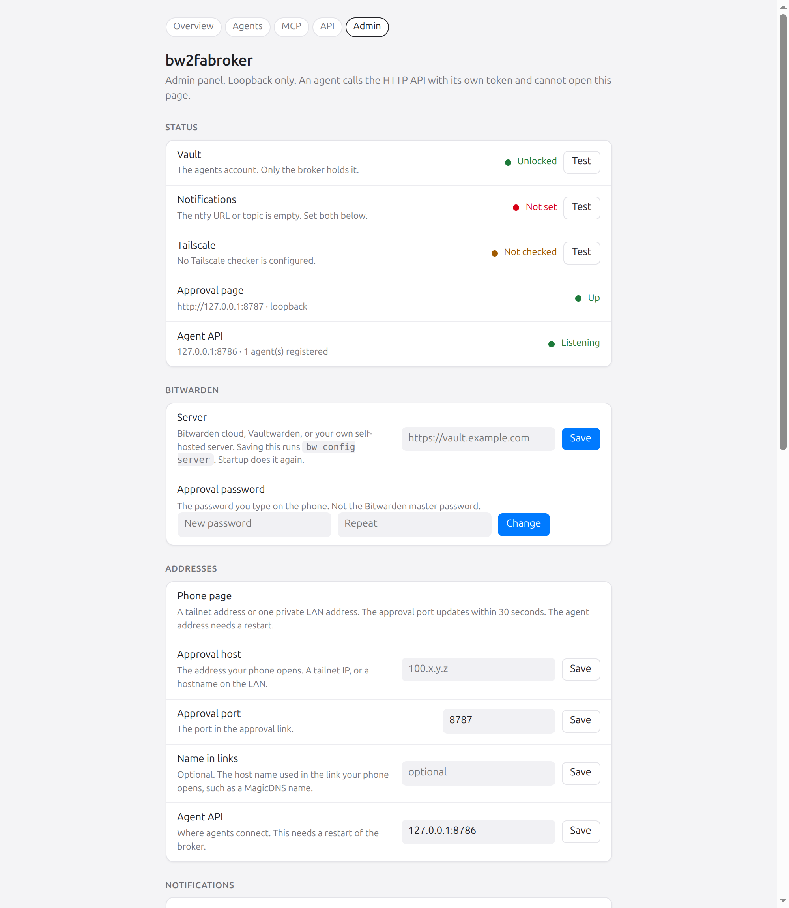
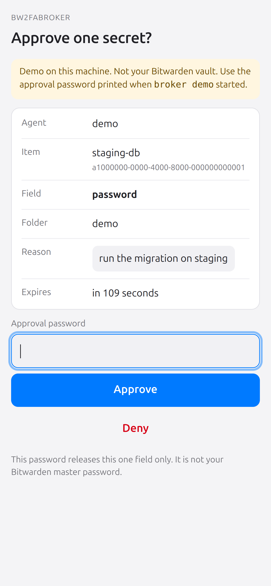
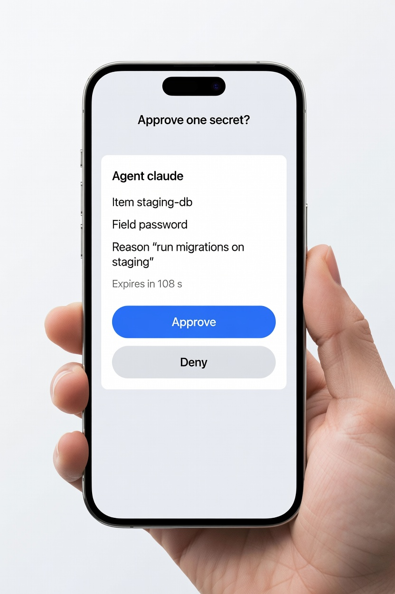
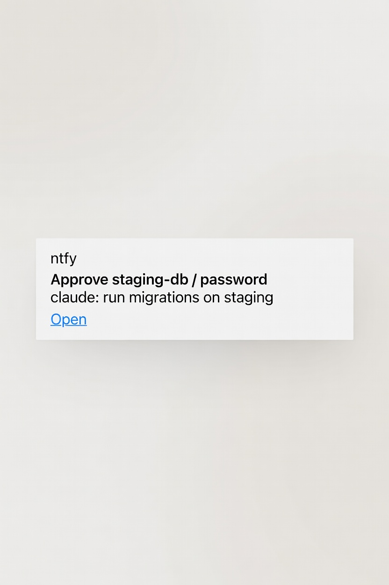
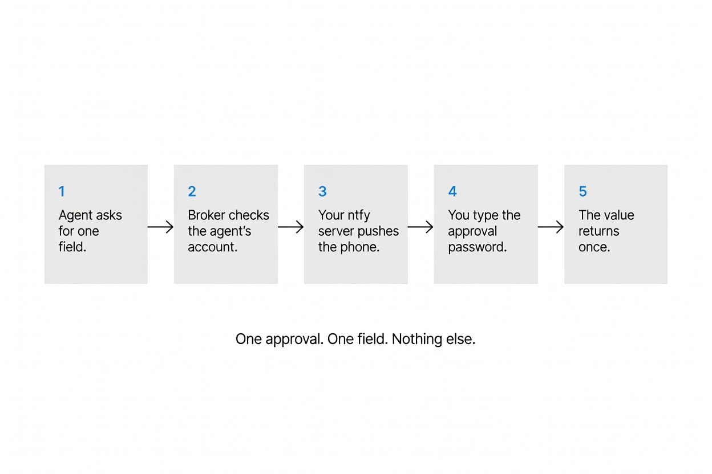
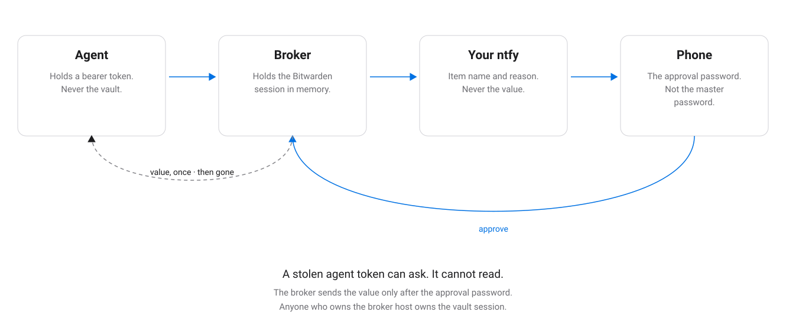

# bw2fabroker

A Go broker in front of the Bitwarden CLI. An agent asks for **one field of one item**. You approve it on your phone. The broker returns that one value once, in a fixed JSON shape, and nothing else.

The broker holds the Bitwarden session. The agent never runs `bw`. The agents account is a separate Bitwarden user that can see one collection. Pending requests live in memory. A restart cancels them. There is no database.

Design notes: [docs/DEV_PLAN.md](docs/DEV_PLAN.md).

## Gallery

The admin page and the approval page below are the real pages. The phone, the notification, and the story are illustrations of the same flow.













## What you need

- Tailscale on the broker host and on your phone. The broker checks that Tailscale is installed and connected when the approval page binds a tailnet address.
- Optional: a self-hosted ntfy server on your own domain, with HTTPS. Without it the broker still
  runs; approval links then go to the broker log and the admin panel. The broker refuses `ntfy.sh`,
  any other domain, plain HTTP, redirects, and a topic that answers without a bearer token.
- A Bitwarden server: Bitwarden cloud, Vaultwarden, or Bitwarden's own self-hosted server. See [Self-hosted Bitwarden](#self-hosted-bitwarden).
- A separate Bitwarden account for agents, with agent-safe items in one organization collection.

## How a request moves

1. The agent calls `POST /v1/requests` with an item, a field, and a reason. The body has no other keys.
2. The broker resolves the item in the agents collection, checks the field exists, and applies the auto rules, the rate limit, and the suspension list.
3. Unless the field is on an auto rule, the broker sends a push to your ntfy topic. The push carries the item name, the field, the agent name, and the reason. It does not carry the value. With no ntfy configured, the same link goes to the broker log and to the admin panel instead.
4. You open the link. The page is on this node's tailnet address, or on one private LAN address. It is never on a public address. You type the **approval password**. That password is not the Bitwarden master password.
5. The broker reads the field and returns it on `GET /v1/requests/{id}/wait`. The value is delivered once. The request then expires.

`broker-get` prints one JSON line and exits 0 (approved), 1 (denied), or 2 (rejected). With `--env`, the line goes to stderr with the value replaced by `[in env VAR]`, and the exit status is the command's own.

## Security model

The picture above is the boundary. This is what each part can and cannot do.

| Who | Can | Cannot |
|---|---|---|
| Agent, with its bearer token | Ask for one field. List names and field names. | Read a value without approval, except a field you put on an auto rule. Open the admin panel. Use the admin token. |
| Broker process | Unlock `bw`, hold `BW_SESSION` in memory, read the one approved field. | Show the value on the approval page, in the audit log, or in the ntfy push. |
| Phone on the tailnet | Open the approval page and approve or deny. | Approve without the approval password. Approve a different request than the one in the link. |
| ntfy server | See the item name, the field, the agent, and the reason. | See the value or the approval password. |
| Broker log and admin panel | Show a pending approval link, and only when no ntfy is configured. Panel access needs the admin token and loopback. | Show the value or the approval password. |
| Anyone who can read the broker host | Read the config, the `bw` data directory, and the process memory. | — |

Consequences, stated plainly:

- The broker host is the trust root. A person who is root there, or in the `docker` group when the broker runs in Docker, can take the vault session. Do not put the agent's OS user in that group.
- An agent token is a bearer token on the tailnet (or on a Unix socket). There is no mTLS. Treat the token like a password. The admin token is a different secret: the config refuses a file where the two hashes match, the agent API rejects the admin token, and the panel rejects an agent token.
- The approval password stops someone who can open the page. It does not stop someone who already owns the broker host.
- Three wrong passwords deny that request. Ten wrong passwords in an hour lock every approval until `broker unlock-approvals`.
- Three denials in ten minutes suspend that agent until the admin panel resumes it.
- Auto rules skip the phone. `totp` cannot be automatic. An auto rule is a standing yes.
- LAN mode keeps the approval password, and it also means every device on that network can open the page. The broker warns at start. Tailnet mode closes the page if Tailscale goes down, and pending requests expire.
- The audit log (`audit.jsonl` next to the config, seven days, plus one JSON line on stderr) records the decision. It does not record the value or either password.
- A secret value is data. If a value contains text that looks like an instruction, the agent is told to ignore it. The HTTP client refuses a response that is not the four contract keys.

What this does not protect against: you approving a request you did not read; an auto rule that is wider than you meant; a malicious agent that you then approve; malware on the broker host.

## Where this is the wrong tool

- You need the secret to stay out of the agent process. The agent receives the value. Prefer `broker-get --env` so it is not also printed.
- Many people must approve, or each person has their own vault. There is one approval password and one ntfy topic.
- The agent must keep working while you are offline. A request dies at 120 seconds, and a restart cancels it.
- You want a password-manager UI, or the agent must create or edit vault items. The agent API is read-only, one field at a time.
- The value is binary, longer than 4 KB, or not UTF-8 text. Those are refused (`value_too_large`).
- You want the public ntfy service, or the approval page on the public internet. Both are refused.
- The Bitwarden account cannot use `bw login --apikey`. The broker does not do interactive SSO.
- High-frequency secrets (a session cookie that changes every minute, a one-time code you did not mean to hand to an agent). TOTP is allowed only as an explicit ask, and it is never automatic.
- Replacing Bitwarden's own access control for humans. Humans keep using Bitwarden. This is the gate in front of agents.

## Self-hosted Bitwarden

The broker does not ship a vault. It points `bw` at a server:

- Bitwarden cloud: `https://vault.bitwarden.com` or `https://vault.bitwarden.eu`
- Vaultwarden, including [deploy/vaultwarden](deploy/vaultwarden/README.md), which listens on `127.0.0.1:8080`
- Bitwarden's own self-hosted server. Install that separately and use its URL, usually `https://vault.example.com`

Set the URL in the admin panel (Bitwarden server) or with `BW_SERVER`. Saving it runs `bw config server`. Startup runs it again from `vault.server`. HTTPS is the normal case. Plain HTTP is accepted only for localhost, a loopback address, a private address, or a tailnet address. For a private CA, set `NODE_EXTRA_CA_CERTS` for the broker user; that variable is passed through to `bw`.

Log in once as the agents account: `bw login --apikey`. Unlock later with that account's master password (`broker unlock` or `BW_MASTER_PASSWORD`). That master password is not the approval password.

## Install (app mode, Linux + systemd)

```sh
make install                    # binaries to /usr/local/bin, systemd unit, user "broker", group "broker-clients"
npm install -g @bitwarden/cli   # bw must be on PATH for the broker user

sudo -u broker -H env BROKER_CONFIG=/etc/bw2fabroker/config.toml HOME=/var/lib/bw2fabroker sh -c '
  broker init --ntfy-domain ntfy.example.com            # prints the admin token once
  BITWARDENCLI_APPDATA_DIR=/var/lib/bw2fabroker/bw bw config server https://vault.example.com
  BITWARDENCLI_APPDATA_DIR=/var/lib/bw2fabroker/bw bw login --apikey   # agents account API key
'
# Open http://127.0.0.1:8788/admin with that token.
sudo systemctl enable --now bw2fabroker
sudo -u broker env BROKER_CONFIG=/etc/bw2fabroker/config.toml broker unlock
sudo -u broker env BROKER_CONFIG=/etc/bw2fabroker/config.toml broker doctor
```

Agents call `http://<tailnet-ip>:<agent-port>` with their own bearer token. There is no agent socket in this setup.

Docker, with a Tailscale sidecar: [deploy/docker/README.md](deploy/docker/README.md).

## Use from an agent

Three clients, one API.

**CLI.** [skills/bw-broker/SKILL.md](skills/bw-broker/SKILL.md)

```sh
export BROKER_TOKEN=bwb_...                 # or BROKER_TOKEN_FILE
export BROKER_URL=http://100.x.y.z:8786

broker-get --env PGPASSWORD staging-db password --reason "run migrations on staging" -- psql -h db -c 'select 1'
broker-get staging-db password --reason "set OPENAI_API_KEY for a local test"
broker-get list
broker-get search staging
```

**HTTP.** [skills/bw-broker-http/SKILL.md](skills/bw-broker-http/SKILL.md)

| Method and path | Body | Result |
|---|---|---|
| `POST /v1/requests` | `{"item","field","reason"}` | `request_id`, `status`, `code`, `value` |
| `GET /v1/requests/{id}/wait` | none | the same object, until it is final |
| `GET /v1/items` | none | names and field names |
| `GET /v1/search?q=` | none | the same, matched by name |

Send `Authorization: Bearer`. A body with an extra key is `rejected` / `bad_request`. A response with anything other than the four keys is ignored by `broker-get` and `broker-mcp`.

Fields: `username`, `password`, `totp`, `uri`, `notes`, `custom:<name>`, `card:<part>`, `identity:<part>`, `attachment:<file>`.

**MCP.** [skills/bw-broker-mcp/SKILL.md](skills/bw-broker-mcp/SKILL.md)

`broker-mcp` speaks MCP on stdin and stdout (protocol `2024-11-05`, `2025-03-26`, and `2025-06-18`). Tools: `list_items`, `search_items`, `request_field`. Resource: `broker://contract`. Prompt: `request-field`. It uses the same `BROKER_URL` and `BROKER_TOKEN`. `request_field` waits, and `isError` is set unless the status is `approved`.

```json
{
  "mcpServers": {
    "bw2fabroker": {
      "command": "broker-mcp",
      "env": {
        "BROKER_URL": "http://100.x.y.z:8786",
        "BROKER_TOKEN": "bwb_…"
      }
    }
  }
}
```

## Admin

| Command | Does |
|---|---|
| `broker init` | Config, HMAC key, approval password (argon2id), loopback admin panel, admin token (printed once) |
| `broker start` / `broker unlock` | Serve, or unlock `bw`. `BW_MASTER_PASSWORD` unlocks at start |
| `broker unlock-approvals` | Clear the lockout after 10 wrong passwords in an hour |
| `broker status`, `broker doctor` | State of the running broker, setup checks |

`passwd`, `ntfy`, `net`, `agent`, `auto`, `admin-token`, and `2fa` are not CLI commands. The panel at `http://127.0.0.1:8788/admin` does that work, and it also sets the Bitwarden server URL. The panel does not run arbitrary `bw` commands. It answers only on loopback.

## Limits

- One approval, one secret, delivered once. Requests expire after 120 seconds.
- 3 wrong passwords deny the request. 10 in an hour lock all approvals.
- 3 denials in 10 minutes suspend the agent until the panel resumes it.
- At most 5 pending requests, and 20 new requests, per agent per 10 minutes.
- If the approver is on a tailnet address and Tailscale goes down, the page closes and pending requests expire.

## Develop

```sh
make vet test     # go vet, gofmt, tests with the race detector
make fuzz         # fuzz the request parser
make docker       # build the image (broker, broker-get, broker-mcp, bw)
```

`go test -tags e2e ./e2e` starts a disposable Vaultwarden, approves a password once, and reads notes, a custom field, a URI, an attachment, a card number, and an identity email. It needs Docker. CI runs it.

## Demo

No Tailscale, no ntfy, no Bitwarden. A fake vault on localhost, with the same approval page:

```sh
make build
./bin/broker demo
```

It prints an approval password, an agent token, and the two URLs. Then:

```sh
export BROKER_TOKEN=...          # printed once at startup
export BROKER_URL=http://127.0.0.1:8786
./bin/broker-get staging-db password --reason "try the demo approval page"
```

`weather` / `custom:api_key` is an auto item. `login` / `totp` always asks. The demo listens on loopback only and never reads a real vault.
